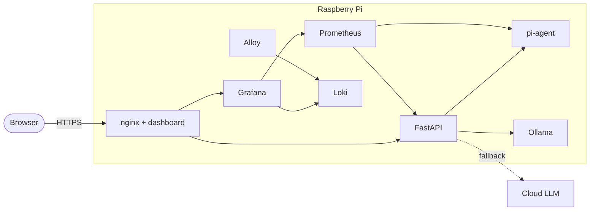

# PiCloud

[](https://github.com/Reec1e33/proj2-raspPI-ai-server/actions/workflows/ci.yml)
[](LICENSE)

A Raspberry Pi home server that I can reach from anywhere, watch from a
dashboard, and ask questions about itself.

It started in early 2025 as a Flask script that served CPU temperature to a
React page. This is the rebuild: a locked-down Pi running a small Docker stack
with real monitoring, logs, alerts, and an LLM gateway that knows what the Pi is
doing right now.


<sub>Running on my laptop with the agent in demo mode, so the Pi numbers are
synthetic. Also: [light mode](docs/images/dashboard-light.png),
[chat](docs/images/chat.png), [Grafana](docs/images/grafana.png).</sub>

## What's in here

- **Host setup** ([`infra/`](infra/)): Bash scripts that take a fresh Pi OS
  install and lock it down. Key-only SSH, UFW, fail2ban, unattended upgrades,
  a static IP, optional dynamic DNS, journald limits, and some sysctl
  hardening. `verify.sh` checks all of it afterwards and tells you what's off.
- **Telemetry agent** ([`agent/`](agent/)): a small Go service that reads
  `/proc`, `/sys`, and the Pi firmware (temperature, clock, throttling,
  under-voltage). It serves JSON for the dashboard and Prometheus metrics.
- **API + AI gateway** ([`api/`](api/)): FastAPI. Streams live stats to the
  dashboard, and has a chat endpoint that tries a local model (Ollama) first and
  falls back to Anthropic or any OpenAI-compatible API. The live stats get added
  to the prompt, so "why is my Pi slow?" gets an answer based on real numbers.
- **Dashboard** ([`web/`](web/)): React + TypeScript + Tailwind. Live charts,
  throttle flags, and the chat.
- **Stack** ([`deploy/`](deploy/)): Docker Compose with nginx in front (TLS,
  basic auth), Prometheus + alert rules, Grafana, Loki, and Grafana Alloy for
  logs.

## How it fits together



Only nginx is exposed (80/443). Everything else stays on the internal Docker
network. More detail in [docs/architecture.md](docs/architecture.md).

## Parts I found interesting

- **Throttle detection broke on newer kernels.** The `get_throttled` file in
  sysfs is gone from Raspberry Pi kernels 6.12+, and the agent runs in a
  distroless image with no `vcgencmd`. So it now talks to the firmware mailbox
  directly with the same ioctl `vcgencmd` uses
  ([`mailbox_linux.go`](agent/internal/collector/mailbox_linux.go)).
- **LLM fallback without mixed answers.** The router retries and falls back
  only before the first token arrives. Once a provider starts streaming, it
  owns the answer. Each provider has a circuit breaker, so a dead Ollama gets
  skipped instead of slowing down every request
  ([`router.py`](api/src/picloud_api/llm/router.py)).
- **Not locking myself out.** The SSH script won't turn off password login
  until the admin user has a working key, checks the config with `sshd -t`, and
  rolls back on failure. The static IP change is applied after the run ends so
  it doesn't kill the SSH session it's running in
  ([`20-ssh.sh`](infra/modules/20-ssh.sh), [`60-network.sh`](infra/modules/60-network.sh)).
- **Docker ignores UFW.** Published Docker ports skip the UFW rules entirely.
  So only nginx publishes ports, Prometheus binds to localhost, and
  `verify.sh` flags anything else that's exposed.
- **Some bugs only a browser caught.** The API used to answer a bad API key
  with a 401, which made Chrome throw away the saved basic-auth login for the
  whole site. It's a 403 now. bcrypt passwords were also too slow for nginx
  basic auth (it checks the hash on every request, and Grafana makes about 100
  requests per page), so the gateway uses SHA-512 crypt.

## Try it on a laptop

No Pi needed. The agent has a demo mode that makes up Pi 5 data. You need Docker
and OpenSSL 3 (on macOS: `brew install openssl@3`, then put it first on your
`PATH`, because the built-in one can't make the password hash).

```sh
git clone https://github.com/Reec1e33/proj2-raspPI-ai-server.git
cd proj2-raspPI-ai-server
make dev-init     # .env, a self-signed cert, and a login (asks for a password)
make dev-up       # builds and starts everything
```

Then open https://localhost:8443 and accept the certificate warning. Grafana is
at `/grafana/`. Stop the stack with `make dev-down`.

The chat needs a model. Either put an `ANTHROPIC_API_KEY` or `OPENAI_API_KEY` in
`deploy/.env`, or run Ollama locally (`llama3.2:1b`, about 1.3 GB). The
[deploy README](deploy/README.md) covers that.

## Putting it on a Pi

Short version:

1. Flash Raspberry Pi OS Lite (64-bit) with your SSH key.
2. Clone this repo to `/opt/picloud` and fill in `infra/config.env`.
3. `sudo infra/bootstrap.sh --dry-run`, then for real, then `sudo infra/verify.sh`.
4. Fill in `deploy/.env`, make a cert and a login, and `docker compose up -d`.
5. Forward 80/443 on your router.

The full walkthrough is in [docs/setup.md](docs/setup.md).

## Tests

CI runs on every push: lint and tests for each part, `promtool` tests for the
alert rules, ShellCheck, and a job that starts the whole stack and runs a
smoke test through nginx. `make check` runs the same checks locally, without the
stack test.

- Go agent: 48 tests, run with the race detector
- API: 153 tests, about 98% coverage
- Dashboard: 124 tests
- Bash: 39 unit tests, plus an end-to-end run in Debian 12 and 13 containers

The host scripts have only run in Debian containers so far, not on real Pi
hardware. That's next.

## More docs

- [Architecture](docs/architecture.md): data flow, ports, what happens when
  something fails
- [Setup](docs/setup.md): from a blank SD card to reaching it from outside
- [Security](docs/security.md): what's protected, how, and the known gaps
- [Operations](docs/operations.md): updates, backups, alerts,
  troubleshooting
- [Decision records](docs/adr/): why Go, why Compose and not k3s, and so on
- Each folder has its own README with the details

## License

[MIT](LICENSE)
