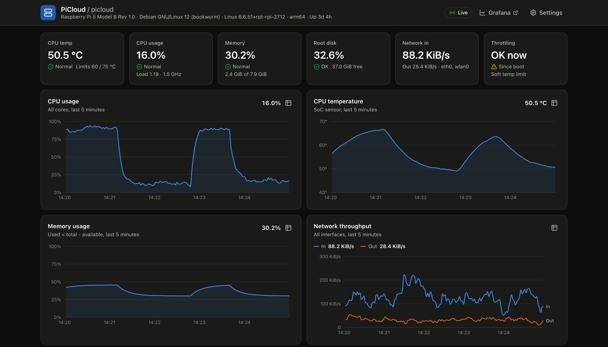
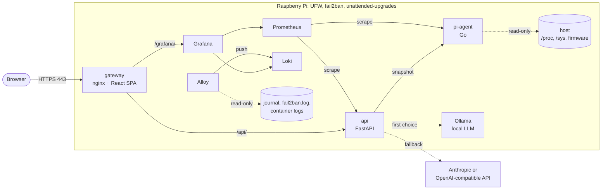

# PiCloud — Raspberry Pi AI Cloud Server

A self-hosted Raspberry Pi server with a hardened host, full observability, and
a multi-provider AI gateway that reads the live telemetry of the Pi.

[](https://github.com/Reec1e33/proj2-raspPI-ai-server/actions/workflows/ci.yml)
[](LICENSE)




*The dashboard on the laptop dev stack. The agent ran in demo mode, so the
Raspberry Pi values are synthetic.*
More screenshots: [light mode](docs/images/dashboard-light.png) ·
[chat and providers](docs/images/chat.png) (a real `llama3.2:1b` answer, CPU only
in Docker on a Mac) · [Grafana](docs/images/grafana.png)

## What it does

**Host hardening and networking** ([`infra/`](infra/README.md))

- Key-only SSH for one admin user, modern algorithms only, and a lockout guard.
- UFW (deny inbound, SSH rate limit, 80/443 only) and fail2ban with longer bans
  for repeat offenders.
- Daily unattended upgrades for Debian, Raspberry Pi and Docker, with a reboot
  window.
- A static IP address (NetworkManager), dynamic DNS (No-IP or Cloudflare),
  journald limits and kernel `sysctl` hardening.
- A read-only audit, `verify.sh`, that prints PASS, WARN, FAIL or SKIP for
  each control.

**Observability** ([`deploy/`](deploy/README.md))

- Prometheus scrapes 6 targets. 11 alert rules cover heat, throttling,
  under-voltage, disk, memory, service health and LLM providers.
- A provisioned Grafana dashboard with 34 panels: host, AI gateway, logs and
  security events.
- Loki and Grafana Alloy collect the container logs, the host journal and the
  fail2ban log.

**AI gateway** ([`api/`](api/README.md))

- One chat endpoint for a local model (Ollama) and cloud models (Anthropic, or
  any OpenAI-compatible API such as Groq).
- An ordered fallback chain with retries and per-provider circuit breakers.
- The system prompt includes the live temperature, load, memory, disk and
  throttle flags, so you can ask "Why is my Pi slow?".
- Streamed answers (SSE) with the provider, the time to first token and the
  latency. Rate limits, an optional API key and Prometheus metrics.

**Dashboard** ([`web/`](web/README.md))

- Live KPI tiles and 5-minute charts over Server-Sent Events.
- The firmware throttle flags, "now" and "since boot".
- A providers panel with the circuit state of each provider.
- An "Ask your Pi" chat with a stop button and a notice for each fallback.

## Architecture



1. The browser connects to the gateway on port 443. nginx terminates TLS,
   checks the basic-auth login and serves the React app.
2. The app opens `/api/system/stream`. The API reads the agent snapshot and
   sends it as an SSE event every 2 seconds.
3. A chat message goes to `POST /api/chat`. The API adds a summary of the live
   telemetry to the system prompt. Then it streams the answer from the first
   provider in the chain that works.
4. Prometheus scrapes the agent and the API every 15 seconds. Alloy sends the
   logs to Loki. Grafana shows both at `/grafana/`.

[docs/architecture.md](docs/architecture.md) gives the data flows, the ports,
the trust boundaries and the failure modes.

## Tech stack

| Layer | Technology |
| --- | --- |
| Host | Raspberry Pi OS Lite 64-bit (Debian 12 or 13), UFW, fail2ban, unattended-upgrades, NetworkManager, ddclient, journald |
| Provisioning | Bash 4.4+, ShellCheck |
| Agent | Go 1.27, `prometheus/client_golang`, distroless static image |
| API | Python 3.12, FastAPI, uvicorn, pydantic, Anthropic and OpenAI SDKs, uv |
| Web | React 19, TypeScript 6.0, Vite 8, Tailwind CSS 4, Recharts 3, Vitest |
| Gateway | nginx 1.30 (unprivileged image), TLS 1.2/1.3, HTTP/2 |
| LLM | Ollama 0.35 (`llama3.2:1b`), Anthropic (`claude-haiku-4-5`), OpenAI-compatible (`gpt-4o-mini` or Groq) |
| Observability | Prometheus 3.15, Grafana 13.2, Loki 3.7, Grafana Alloy 1.20 |
| Delivery | Docker Compose, GitHub Actions, multi-arch images on GHCR (`linux/amd64`, `linux/arm64`) |

## Engineering highlights

- **No answer mixes two models.** Before the first token, the router retries
  transient errors with exponential backoff and jitter, then moves to the next
  provider. After the first token, it never changes provider. Each provider has
  a circuit breaker, and a bad request or an unknown model from the caller
  does not trip it.
  [`router.py`](api/src/picloud_api/llm/router.py)
- **Correct rates from raw counters.** The agent computes CPU usage and network
  rates as deltas between samples. It clamps each CPU field delta at zero,
  because iowait can go back on some kernels. A counter that resets gives a rate
  of 0. The rates use the monotonic clock, because NTP can step the clock of a
  Pi with no RTC. Demo data goes through the same code.
  [`sample.go`](agent/internal/collector/sample.go),
  [`demo.go`](agent/internal/demo/demo.go)
- **Throttle state on current kernels.** Raspberry Pi kernels 6.12 and later
  have no `get_throttled` file in sysfs, and the distroless image has no
  `vcgencmd`. The agent then sends the same `GET_GENCMD_RESULT` request as
  `vcgencmd`, through an `ioctl` on the firmware mailbox device.
  [`host.go`](agent/internal/collector/host.go),
  [`mailbox.go`](agent/internal/collector/mailbox.go),
  [`mailbox_linux.go`](agent/internal/collector/mailbox_linux.go)
- **Host changes that cannot lock you out.** The SSH module refuses to turn
  off password login until the admin user has a valid key. It tests the new
  file with `sshd -t` and rolls back on failure. A new static IP address applies
  from a systemd timer after the run ends, so the run never cuts its own SSH
  session. Each module has a dry run, and a second run makes no changes.
  [`20-ssh.sh`](infra/modules/20-ssh.sh),
  [`60-network.sh`](infra/modules/60-network.sh),
  [`common.sh`](infra/lib/common.sh)
- **Docker ports and UFW.** Docker's iptables rules come before the UFW rules,
  so a published port is open even when UFW denies it. Only the gateway
  publishes ports, Prometheus binds to `127.0.0.1`, and `verify.sh` warns about
  any other published port.
  [`verify.sh`](infra/verify.sh),
  [`docker-compose.yml`](deploy/docker-compose.yml)
- **SSE through nginx.** The gateway turns off proxy buffers and does not gzip
  `text/event-stream`. The browser reconnects with backoff, and a watchdog
  catches a stalled stream that `EventSource` cannot see. A bad chat key gets
  `403`, not `401`: a test in Chromium showed that one `401` makes the browser
  drop the cached basic-auth login.
  [`picloud.conf.template`](deploy/nginx/templates/picloud.conf.template),
  [`sse.py`](api/src/picloud_api/sse.py),
  [`useSystemStream.ts`](web/src/hooks/useSystemStream.ts)
- **Least-privilege, multi-arch containers.** All eight services drop all
  capabilities, set `no-new-privileges` and use a read-only root filesystem.
  The agent image is a static Go binary on distroless (about 4.2 MB). The Go and
  Node build stages cross-compile on the build platform, so they need no
  emulation. CI publishes `amd64` and `arm64` images with an SBOM and
  provenance.
  [`agent/Dockerfile`](agent/Dockerfile),
  [`deploy/nginx/Dockerfile`](deploy/nginx/Dockerfile),
  [`images.yml`](.github/workflows/images.yml)
- **Tests at each layer.** The agent has 94.0 % statement coverage, and the API
  has 98.48 % branch coverage. CI also runs the web tests, the Bash tests and
  the `promtool` tests of the alert rules. One CI job starts the laptop stack
  and runs the smoke test. See [Tests](#tests).

## Quick start (laptop demo)

This demo runs the stack on macOS or Linux, with no Pi. The agent runs in
demo mode and sends synthetic Raspberry Pi 5 data.

You need Docker with Compose 2.24.4 or later, OpenSSL 3, `curl` and `jq`. The
`openssl` of macOS is LibreSSL, which cannot make the password hash. On macOS,
run `brew install openssl@3`, then
`export PATH="$(brew --prefix openssl@3)/bin:$PATH"` in the same shell.

1. Clone the repository and copy the settings:

   ```sh
   git clone https://github.com/Reec1e33/proj2-raspPI-ai-server.git
   cd proj2-raspPI-ai-server/deploy
   cp .env.example .env && chmod 600 .env
   ```

2. Edit `.env`. Set `GRAFANA_ADMIN_PASSWORD` to a new value. For a local LLM in
   Docker, also set these two lines. Without them, the chat needs a cloud key
   (`ANTHROPIC_API_KEY` or `OPENAI_API_KEY`).

   ```text
   COMPOSE_PROFILES=dev-ollama
   PICLOUD_DEV_OLLAMA_URL=http://ollama:11434
   ```

3. Make a certificate and a gateway user. The second script asks for a
   password of 12 characters or more:

   ```sh
   ./scripts/gen-self-signed-cert.sh localhost
   ./scripts/create-htpasswd.sh admin
   ```

4. Build and start the stack. The first build takes some minutes:

   ```sh
   docker compose -f docker-compose.yml -f docker-compose.dev.yml up -d --build --wait
   ```

5. If you set `COMPOSE_PROFILES=dev-ollama`, download the model (about 1.3 GB):

   ```sh
   ./scripts/pull-model.sh
   ```

6. Run the smoke test:

   ```sh
   SMOKE_USER=admin SMOKE_PASSWORD='<your password>' SMOKE_HTTP_URL=http://localhost:8080 \
     ./scripts/smoke-test.sh https://localhost:8443
   ```

7. Open <https://localhost:8443> and accept the warning for the self-signed
   certificate. Grafana is at <https://localhost:8443/grafana/>.

To stop the stack, run
`docker compose -f docker-compose.yml -f docker-compose.dev.yml down`.

The root `Makefile` has shortcuts for these steps: `make dev-init`,
`make dev-up`, `make smoke` and `make dev-down`. `make help` lists all targets.

## Deploy on a Raspberry Pi

1. Write Raspberry Pi OS Lite (64-bit) to the SD card, with your SSH key.
2. Clone the repository to `/opt/picloud`, and set `ADMIN_USER` in
   `infra/config.env`.
3. Run `sudo ./bootstrap.sh --dry-run`, then `sudo ./bootstrap.sh`, then
   `sudo ./verify.sh`.
4. Set `deploy/.env`, make a certificate and a gateway user, then run
   `docker compose pull` and `docker compose up -d --wait`.
5. Forward ports 80 and 443 on the router. Optional: dynamic DNS and a Let's
   Encrypt certificate.

[docs/setup.md](docs/setup.md) gives each step, from a blank SD card to a test
from the internet.

## Documentation

| Document | Content |
| --- | --- |
| [docs/architecture.md](docs/architecture.md) | Components, data flows, ports, trust boundaries, failure modes |
| [docs/setup.md](docs/setup.md) | Step-by-step setup on a Raspberry Pi |
| [docs/security.md](docs/security.md) | Threat model, controls and their files, known limitations |
| [docs/operations.md](docs/operations.md) | Updates, secrets, backups, logs, alerts, troubleshooting |
| [docs/adr/](docs/adr/README.md) | Architecture decision records |
| Component READMEs | [agent](agent/README.md), [api](api/README.md), [web](web/README.md), [deploy](deploy/README.md), [infra](infra/README.md) |

## Repository layout

```text
.
├── agent/      Go host telemetry agent (pi-agent)
├── api/        FastAPI system API and AI gateway
├── web/        React dashboard, built into the gateway image
├── deploy/     Docker Compose stack: nginx gateway, Prometheus, Grafana, Loki, Alloy, scripts
├── infra/      Bash host provisioning and audit (bootstrap.sh, verify.sh)
├── docs/       Architecture, setup, security, operations, ADRs, screenshots
└── .github/    CI, image and release workflows
```

## Tests

[CI](.github/workflows/ci.yml) runs the checks of each component when its
directory changes. A separate job builds the laptop stack, starts it and runs
the smoke test through the gateway. On your machine, `make check` runs all lint
and test steps of CI except the stack test.

| Component | Command | Scope | Local result (2026-10-21) |
| --- | --- | --- | --- |
| agent | `make -C agent lint test` | gofmt, go vet, staticcheck. Parsers, delta calculations, throttle bits, mailbox buffer, exporter and HTTP routes, with the race detector. | 48 tests (107 with subtests), 94.0 % statement coverage |
| api | `cd api && uv run ruff check && uv run mypy && uv run pytest` | Lint and strict types. Retries, fallback and circuit breaker, provider wire formats, SSE, rate limit, API key, validation. | 153 tests, 98.54 % branch coverage (the gate is 85 %) |
| web | `cd web && pnpm install && pnpm lint && pnpm typecheck && pnpm test --run` | SSE parser, reconnect and watchdog, stale state, chat state machine, Markdown subset, components. | 124 tests in 12 files. Statement coverage 88.46 % (measured once with `@vitest/coverage-v8`, which the repository does not include). |
| infra | `bash infra/tests/run.sh` | File changes and rollback, dry run, configuration checks, SSH lockout guard, firewall dry run, audit parsers. ShellCheck in CI. | 39 tests |
| infra, end to end | `infra/tests/e2e.sh bookworm` | Dry run, real run, a second run with no changes, and `verify.sh`, in a Debian container with systemd. Not in CI: it needs privileged containers. | Passes on Debian 12 (bookworm) and Debian 13 (trixie). Only the `sysctl` checks fail, because a container cannot change kernel settings. |
| deploy | [Config checks](deploy/README.md#checks) | `promtool` unit tests for the 11 alert rules, Compose, Alloy, Loki and nginx configuration. | All pass |
| stack | `deploy/scripts/smoke-test.sh` | 15 checks through the gateway: auth, headers, snapshot contract, SSE, providers, Grafana, hidden `/metrics`, HTTPS redirect. | 15 of 15 |

An integration run on 2026-10-02 used the laptop stack on an Apple-silicon Mac
(Docker VM, CPU only, not a Pi):

- 6 of 6 Prometheus targets were up. All 46 Grafana panel queries ran with
  0 errors.
- SSE events arrived through the gateway every 2.002 to 2.008 s.
- Real `llama3.2:1b` answers streamed through the gateway. With a warm model
  on a quiet host, the median of 9 runs was 725 ms to the first token and
  1.26 s in total.

No test of version 2 ran on Pi hardware yet. The host modules ran in Debian 12
and 13 arm64 containers with systemd. The Pi-specific agent code has fixture tests.
[docs/security.md](docs/security.md#known-limitations) lists the other limits.

## Project history

Version 1 (January and February 2025) was a Flask and React prototype. It had a
Flask `/metrics` endpoint on port 5000, a Create React App dashboard and No-IP
dynamic DNS. Version 2 (2026) is a full rebuild. The
[changelog](CHANGELOG.md) gives the changes.

## License

[MIT](LICENSE) © 2025-2026 Reece Roskam
