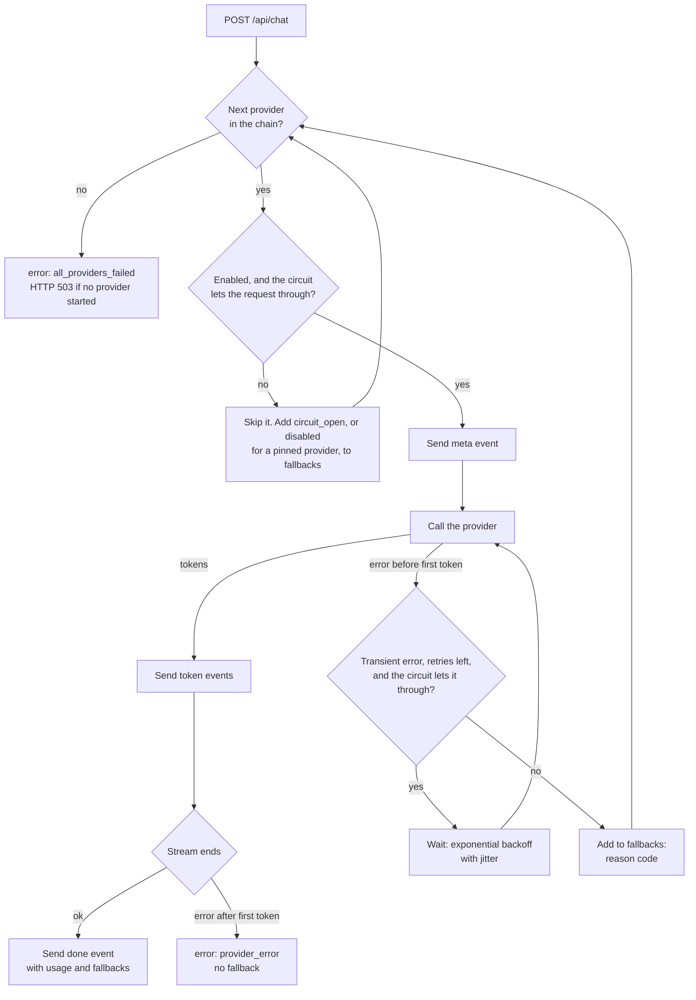

# PiCloud API

The PiCloud API is the FastAPI service that sits behind the Nginx gateway. It has two jobs:

- It gives the web dashboard the host telemetry from `pi-agent`, as JSON and as a live Server-Sent Events (SSE) stream.
- It is an AI gateway. It sends chat requests to a local model (Ollama) or to a cloud model (Anthropic, OpenAI-compatible), with fallback, retries and circuit breakers.

The chat prompt can include a short summary of the live telemetry. Thus a user can ask "Why is my Pi hot?" and get an answer that uses the real numbers.

The service runs on Python 3.12 with uvicorn on port 8000. It writes one JSON log line per event to stdout and exposes Prometheus metrics on `/metrics`.

## Endpoints

| Method | Path | Description |
|--------|------|-------------|
| `GET` | `/api/health` | Liveness. Always `200` while the process runs. The container `HEALTHCHECK` uses it. |
| `GET` | `/api/ready` | Readiness. `200 ready` when the agent answers and one or more providers are enabled. Otherwise `503 degraded`, with one result per check. |
| `GET` | `/api/system` | The latest agent snapshot, validated against the agent contract. `503 {"detail": "agent unavailable"}` when the agent fails. |
| `GET` | `/api/system/stream` | SSE. A `snapshot` event each `PICLOUD_STREAM_INTERVAL_S`. An `error` event when the agent fails; the stream stays open. A `: ping` comment each 15 s. |
| `GET` | `/api/providers` | The providers in fallback order, with `enabled`, `local`, `model` and `circuit` (`closed`, `open` or `half_open`). |
| `POST` | `/api/chat` | Chat. SSE when `stream` is `true` (the default), one JSON object when `stream` is `false`. |
| `GET` | `/metrics` | Prometheus metrics. Nginx does not expose this path. |
| `GET` | `/api/docs` | Interactive OpenAPI documentation. |

### Chat request

```json
{
  "messages": [{"role": "user", "content": "Why is my Pi slow?"}],
  "provider": null,
  "model": null,
  "include_system_context": true,
  "stream": true,
  "max_tokens": null,
  "temperature": null
}
```

The API applies these rules:

- A request has 1 to 50 messages. Each message has 1 to 8000 characters. The last message must have the role `user`.
- The API caps `max_tokens` at `PICLOUD_MAX_TOKENS`.
- `provider` puts that provider first. The other providers follow in the configured order.
- `model` replaces the model of the first provider in the chain only. Each fallback provider uses its own configured model.
- When `include_system_context` is `true`, the system prompt includes the temperature, CPU, memory, disk, throttle flags, uptime and Pi model. If the agent is down, the prompt tells the model that live data is not available.

### Chat stream events

| Event | Data | When |
|-------|------|------|
| `meta` | `{"request_id", "provider", "model"}` | The router starts to use a provider. A fallback sends a new `meta`. |
| `token` | `{"text"}` | Each text chunk from the provider. |
| `done` | `{"provider", "model", "usage", "latency_ms", "ttft_ms", "fallbacks"}` | The reply is complete. |
| `error` | `{"code", "message"}` | `all_providers_failed`, or `provider_error` when a provider fails after the first token. |

The HTTP status codes are:

- `403`: the `X-API-Key` header is not present or not correct. The API does not send `401`,
  because the gateway's basic auth uses `401`. A browser that gets a `401` deletes the basic-auth
  credentials that it sent, and then asks for the site password again.
- `422`: the request is not valid. The body gives the location and the message of each error. It does not repeat the input.
- `429`: the client is over the rate limit. The `Retry-After` header gives the wait in seconds.
- `502`: the provider failed after the first token, with `stream: false` only.
- `503`: no provider could start a reply.

## Configuration

All settings come from environment variables.

| Variable | Default | Description |
|----------|---------|-------------|
| `PICLOUD_AGENT_URL` | `http://agent:9110` | The base URL of `pi-agent`. |
| `PICLOUD_PROVIDER_ORDER` | `ollama,anthropic,openai` | The fallback chain. The router skips disabled providers. |
| `PICLOUD_OLLAMA_URL` | `http://ollama:11434` | The Ollama base URL. An empty value disables Ollama. |
| `PICLOUD_OLLAMA_MODEL` | `llama3.2:1b` | The Ollama model. |
| `ANTHROPIC_API_KEY` | not set | Enables Anthropic. |
| `PICLOUD_ANTHROPIC_MODEL` | `claude-haiku-4-5` | The Anthropic model. |
| `OPENAI_API_KEY` | not set | Enables the OpenAI-compatible provider. |
| `PICLOUD_OPENAI_BASE_URL` | `https://api.openai.com/v1` | Any OpenAI-compatible endpoint, for example Groq at `https://api.groq.com/openai/v1`. |
| `PICLOUD_OPENAI_MODEL` | `gpt-4o-mini` | The OpenAI-compatible model. |
| `PICLOUD_API_KEY` | not set | When set, `POST /api/chat` requires this value in the `X-API-Key` header. |
| `PICLOUD_CHAT_RATE_LIMIT` | `20/minute` | The chat budget per client IP. The unit is `second`, `minute`, `hour` or `day`. |
| `PICLOUD_MAX_TOKENS` | `1024` | The maximum output tokens for each reply. |
| `PICLOUD_REQUEST_TIMEOUT_S` | `60` | The provider timeout, in seconds. |
| `PICLOUD_STREAM_INTERVAL_S` | `2` | The interval between `snapshot` events, in seconds. |
| `PICLOUD_CORS_ORIGINS` | empty | A comma-separated list of allowed origins. Use `http://localhost:5173` for the Vite dev server. |
| `PICLOUD_LOG_LEVEL` | `info` | `debug`, `info`, `warning`, `error` or `critical`. |
| `PICLOUD_LOG_FORMAT` | `json` | `json` for Loki, or `console` for local work. |
| `FORWARDED_ALLOW_IPS` | `127.0.0.1` | Read by uvicorn. It gives the proxy addresses or CIDR ranges that can set `X-Forwarded-For`. |

An empty key has the same effect as a key that is not set.

## Provider fallback



The router obeys these rules:

- Transient errors are connection errors, timeouts, HTTP 429 and HTTP 5xx. The router retries them 2 times before the first token. The waits are 0.5 to 1 s, then 1 to 2 s.
- The router does not retry permanent errors, for example HTTP 401 or an unknown model.
- After the first token, the router never changes provider. The client already shows part of the reply, so the router sends an `error` event.
- Each provider has a circuit breaker. The circuit opens after 3 consecutive failed calls. After 30 s, the circuit goes to half-open.
- In the half-open state, the router lets one trial request call the provider. Until the trial ends, other requests skip the provider with the reason `circuit_open`.
- A successful trial closes the circuit. A failed trial opens the circuit again for 30 s.
- If the client disconnects during the trial, or the trial error does not count as a circuit failure, the circuit stays half-open. The next request becomes the trial.
- The router examines the circuit before and after each backoff wait. When the circuit stops the request, the router does not retry that provider.
- A `bad_request` error does not count as a circuit failure, because it shows a problem with the request, not with the provider. A `not_found` error for a model that the client gave in `model` does not count either.
- The SDK retries are off. The router owns all retries, so the waits do not multiply.

## Security

- The API compares the `X-API-Key` value in constant time. It does not use the `Authorization` header, because Nginx basic auth uses that header.
- The rate limit is an in-memory token bucket for each client IP. The state is local to one process, which agrees with the single uvicorn worker.
- Uvicorn replaces the client address with the `X-Forwarded-For` value only when the peer is in `FORWARDED_ALLOW_IPS`. A client that connects directly cannot change its rate-limit key with that header.
- The logs never contain prompts, replies or API keys. The API sets the SDK and HTTP client loggers to `WARNING` or higher, because their debug output includes request bodies.
- The container runs as an unprivileged user and works with a read-only root file system.

## Observability

- Each request gets an `X-Request-ID`. The API keeps a safe value from the gateway, or it makes a new one. The ID is in the response header, in each log line of the request and in the chat `meta` event.
- The API writes one JSON access log line per request. The `/metrics`, `/api/health` and `/api/ready` probes log at `debug` level only.
- `/metrics` exposes `picloud_http_requests_total`, `picloud_http_request_duration_seconds`, `picloud_chat_requests_total`, `picloud_chat_tokens_total`, `picloud_chat_ttft_seconds`, `picloud_chat_duration_seconds`, `picloud_provider_fallbacks_total`, `picloud_provider_circuit_state` and `picloud_build_info`, plus the standard `process_` and `python_` metrics.
- `picloud_chat_requests_total{outcome="error"}` counts each provider that failed a request. When the router can try no provider (none is enabled, or each circuit is open), the request counts as `provider="none"`.
- The `route` label holds the path template, for example `/api/system`, so the label count stays small. A path with no route gets the label `unmatched`.

## Local development

You need [uv](https://docs.astral.sh/uv/). uv installs Python 3.12 if it is not on the machine.

1. Install the dependencies:

   ```sh
   cd api
   uv sync
   ```

2. Run the checks. The test run fails if the coverage is below 85 %.

   ```sh
   uv run ruff check
   uv run ruff format --check
   uv run mypy
   uv run pytest
   ```

3. Start the server with automatic reload. Set the URLs and keys for the services that you have.

   ```sh
   PICLOUD_AGENT_URL=http://localhost:9110 \
   PICLOUD_OLLAMA_URL=http://localhost:11434 \
   PICLOUD_CORS_ORIGINS=http://localhost:5173 \
   PICLOUD_LOG_FORMAT=console \
   uv run uvicorn picloud_api.main:app --reload --port 8000
   ```

4. To get telemetry on macOS, start `pi-agent` with `PI_AGENT_DEMO=true`.

The tests do not need a network or real API keys. `respx` intercepts the HTTP calls of the Ollama client, the `anthropic` SDK and the `openai` SDK. Both SDKs use `httpx2`, so `tests/_alias_httpx.py` makes `httpx` resolve to `httpx2` before `respx` loads.

## Container image

The `Dockerfile` has two stages:

1. The build stage uses `uv` to make a virtual environment from `uv.lock`, with `--frozen --no-dev`.
2. The runtime stage copies only that virtual environment into the same pinned base image, `python:3.12.15-slim-trixie`.

Build and run the image from the repository root:

```sh
docker build -t picloud-api api/
docker run --rm -p 8000:8000 --read-only --cap-drop ALL picloud-api
```

In the compose stack, set `FORWARDED_ALLOW_IPS` to the address or subnet of the gateway.
