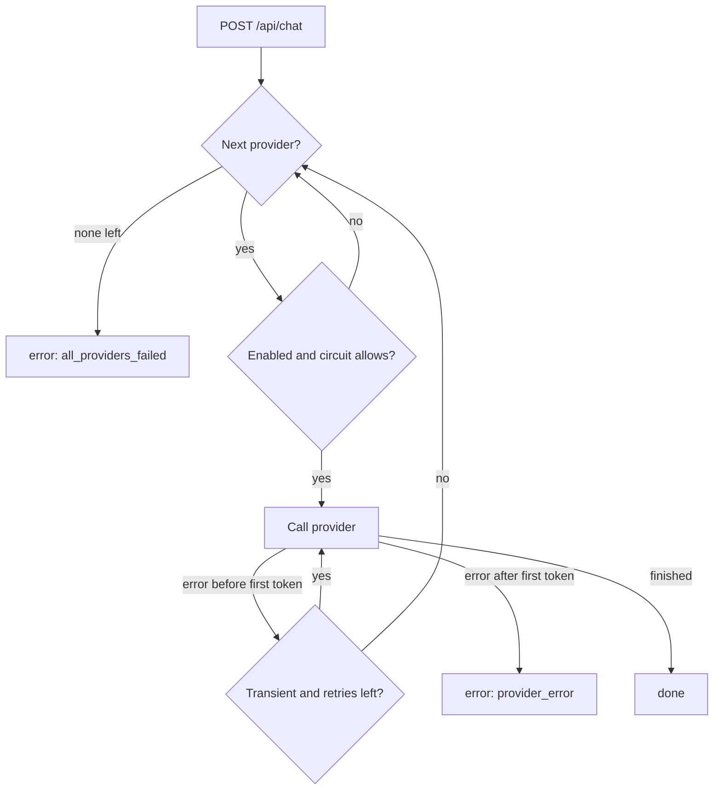

# PiCloud API

The FastAPI service behind the nginx gateway. It passes `pi-agent` telemetry to
the dashboard (as JSON and as a Server-Sent Events stream), and it's the AI
gateway: chat requests go to Ollama first and fall back to Anthropic or any
OpenAI-compatible API.

Chat can include a summary of the live telemetry in the system prompt, so "why
is my Pi hot?" gets answered from the real numbers.

## Running it locally

You need [uv](https://docs.astral.sh/uv/). It will fetch Python 3.12 if you
don't have it.

```sh
cd api
uv sync
PICLOUD_AGENT_URL=http://localhost:9110 \
PICLOUD_OLLAMA_URL=http://localhost:11434 \
PICLOUD_CORS_ORIGINS=http://localhost:5173 \
PICLOUD_LOG_FORMAT=console \
uv run uvicorn picloud_api.main:app --reload --port 8000
```

On a laptop, run the agent in demo mode (`PI_AGENT_DEMO=true`, see the
[agent README](../agent/README.md)) to get telemetry. Set whichever provider
URLs and keys you have.

The image builds from this folder (`docker build -t picloud-api api/` from the
repo root) and runs fine with `--read-only --cap-drop ALL`.

## Configuration

All environment variables. An empty key counts as unset.

| Variable | Default | Notes |
| --- | --- | --- |
| `PICLOUD_AGENT_URL` | `http://agent:9110` | `pi-agent` base URL |
| `PICLOUD_PROVIDER_ORDER` | `ollama,anthropic,openai` | Fallback order; disabled providers are skipped |
| `PICLOUD_OLLAMA_URL` | `http://ollama:11434` | Empty disables Ollama |
| `PICLOUD_OLLAMA_MODEL` | `llama3.2:1b` | |
| `ANTHROPIC_API_KEY` | unset | Enables Anthropic |
| `PICLOUD_ANTHROPIC_MODEL` | `claude-haiku-4-5` | |
| `OPENAI_API_KEY` | unset | Enables the OpenAI-compatible provider |
| `PICLOUD_OPENAI_BASE_URL` | `https://api.openai.com/v1` | Any compatible endpoint, e.g. Groq's |
| `PICLOUD_OPENAI_MODEL` | `gpt-4o-mini` | |
| `PICLOUD_API_KEY` | unset | If set, `POST /api/chat` needs it in `X-API-Key` |
| `PICLOUD_CHAT_RATE_LIMIT` | `20/minute` | Per client IP; unit is `second`, `minute`, `hour` or `day` |
| `PICLOUD_MAX_TOKENS` | `1024` | Cap on output tokens per reply |
| `PICLOUD_REQUEST_TIMEOUT_S` | `60` | Provider timeout |
| `PICLOUD_STREAM_INTERVAL_S` | `2` | Seconds between `snapshot` events |
| `PICLOUD_CORS_ORIGINS` | empty | Comma-separated |
| `PICLOUD_LOG_LEVEL` | `info` | `debug`, `info`, `warning`, `error`, `critical` |
| `PICLOUD_LOG_FORMAT` | `json` | `json` or `console` |
| `FORWARDED_ALLOW_IPS` | `127.0.0.1` | Read by uvicorn: which peers may set `X-Forwarded-For`. Compose sets it to the gateway |

## Endpoints

| Method | Path | Notes |
| --- | --- | --- |
| `GET` | `/api/health` | Liveness. 200 while the process is up |
| `GET` | `/api/ready` | 200 if the agent answers and at least one provider is enabled, else 503 with per-check results |
| `GET` | `/api/system` | Latest agent snapshot, or 503 if the agent is down |
| `GET` | `/api/system/stream` | SSE: `snapshot` events, `error` events while the agent is down, `: ping` every 15 s |
| `GET` | `/api/providers` | Providers in fallback order with model and circuit state |
| `POST` | `/api/chat` | SSE by default, or one JSON response with `"stream": false` |
| `GET` | `/metrics` | Prometheus. nginx doesn't expose it |
| `GET` | `/api/docs` | OpenAPI UI |

A chat request only needs `messages` (up to 50, each up to 8000 characters,
the last from the user). The optional fields are `provider`, `model`,
`include_system_context` (default `true`), `stream` (default `true`),
`max_tokens` and `temperature`. `provider` moves that provider to the front of
the chain, and `model` only applies to that first provider.

The chat stream sends `meta` each time a provider starts, then `token` events,
then `done` with usage, timings and fallbacks, or `error` with
`all_providers_failed` or `provider_error`. Status codes: 403 for a bad API
key, 429 with `Retry-After`, 503 when no provider could start, and 502 when a
non-streaming reply fails partway.

Metrics: `picloud_http_requests_total`, `picloud_http_request_duration_seconds`,
`picloud_chat_requests_total`, `picloud_chat_tokens_total`,
`picloud_chat_ttft_seconds`, `picloud_chat_duration_seconds`,
`picloud_provider_fallbacks_total`, `picloud_provider_circuit_state` and
`picloud_build_info`.

## Tests

```sh
uv run ruff check
uv run ruff format --check
uv run mypy
uv run pytest      # fails under 85% coverage
```

No network or real keys needed. `respx` intercepts the HTTP calls from Ollama
and both SDKs. The SDKs use `httpx2`, so `tests/_alias_httpx.py` aliases `httpx`
to it before `respx` loads.

## Design notes



- **Fallback only before the first token.** Connection errors, timeouts, 429s
  and 5xx get two retries with jittered exponential backoff. Anything else
  (a 401, an unknown model) moves straight to the next provider. Once tokens
  are flowing the router won't switch, because the user would see two answers
  stitched together. SDK retries are turned off so the backoffs don't multiply.
- **Circuit breakers.** A provider's circuit opens after 3 failures in a row
  and goes half-open after 30 s. Half-open lets exactly one trial request
  through; others skip the provider until it finishes. Success closes the
  circuit, failure reopens it, and a trial that ends without a verdict (client
  disconnected) frees the slot for the next request. A bad request, or a 404
  for a model the client picked, doesn't count, so one client can't trip the
  circuit for everyone. See [`router.py`](src/picloud_api/llm/router.py).
- **403, not 401, for a bad API key.** The gateway's basic auth owns 401, and a
  browser that sees one throws away its saved site login. The key goes in
  `X-API-Key` because basic auth already uses `Authorization`.
- **Rate limiting is an in-memory token bucket per client IP**, which is fine
  with one uvicorn worker. Uvicorn only trusts `X-Forwarded-For` from
  `FORWARDED_ALLOW_IPS`, so a direct client can't fake its address.
- **Logs never contain prompts, replies or keys.** The SDK and HTTP client
  loggers stay at `WARNING` or above because their debug output includes
  request bodies.
