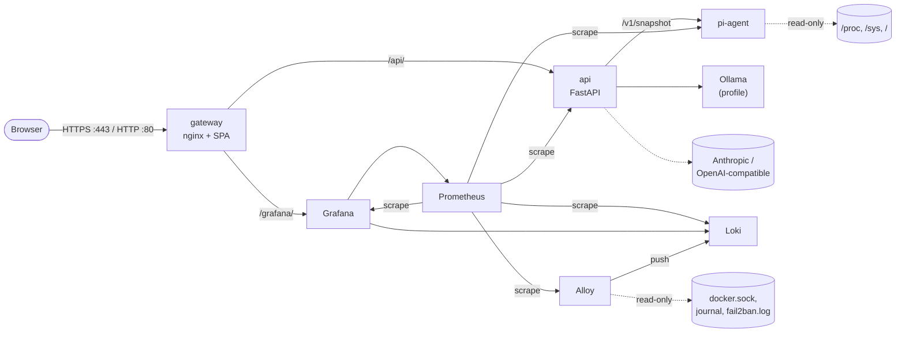

# PiCloud deploy

This directory contains the Docker Compose stack for PiCloud. The stack runs on
one Raspberry Pi 4 or 5 (arm64, 4 GB or 8 GB). It has these parts:

- An nginx gateway that serves the web dashboard and terminates TLS.
- The api: the AI gateway and the system API.
- The host telemetry agent (`pi-agent`).
- An optional local LLM (Ollama).
- A metrics and log stack: Prometheus, Grafana, Loki and Alloy.

## Stack



| Path | Content |
| --- | --- |
| `docker-compose.yml` | The stack for the Pi. |
| `docker-compose.dev.yml` | The override for a laptop (macOS or Linux). |
| `.env.example` | All settings, with defaults and 4 GB values. |
| `nginx/` | Gateway image: `Dockerfile`, `nginx.conf`, `templates/`, `snippets/`. |
| `prometheus/` | Scrape config, alert rules and rule unit tests. |
| `grafana/` | Provisioned datasources and the `PiCloud overview` dashboard. |
| `loki/config.yml` | Single-binary Loki: TSDB index, filesystem chunks, 7-day retention. |
| `alloy/config.alloy` | Log collection: Docker containers, systemd journal, fail2ban. |
| `scripts/` | Certificate, htpasswd, model, backup and smoke-test scripts. |

## Quick start on the Pi

Before you start, run `infra/bootstrap.sh` on the Pi. It installs Docker and the
`picloud.service` unit, and adds the admin user to the `docker` group. The
repository must be in `/opt/picloud`.

1. Go to the deploy directory:

   ```sh
   cd /opt/picloud/deploy
   ```

2. Copy the settings template. The file contains API keys, so give read access
   to its owner only:

   ```sh
   cp .env.example .env && chmod 600 .env
   ```

   > **Warning:** Do not keep the example Grafana password. If you keep it, any
   > person with gateway credentials can log in to Grafana as the administrator.
   > Grafana reads the password only at its first start. See
   > [Operations](#operations) to change it later.

3. Edit `.env`. Set `SERVER_NAME`, `GRAFANA_ADMIN_PASSWORD` and the provider
   keys. Make a password with `openssl rand -base64 24`. If `ls /dev/vcio_gencmd`
   finds the device, also set `PI_AGENT_MAILBOX_DEVICE=/dev/vcio_gencmd`. See
   [Throttle state](#throttle-state).
4. Make a TLS certificate for `SERVER_NAME`. Add other names or the LAN address
   as arguments. For a public DNS name, see [Let's Encrypt](#lets-encrypt-certificate).

   ```sh
   sudo ./scripts/gen-self-signed-cert.sh picloud.local IP:192.168.1.50
   ```

5. Make a basic-auth user for the gateway:

   ```sh
   sudo ./scripts/create-htpasswd.sh admin
   ```

6. Get the images. `pull` downloads the images that CI publishes. `build`
   builds them on the Pi, which is slow.

   ```sh
   docker compose pull    # or: docker compose build
   ```

7. Start the stack:

   ```sh
   docker compose up -d --wait
   ```

8. Download the default model for Ollama:

   ```sh
   ./scripts/pull-model.sh
   ```

9. Test the stack through the gateway:

   ```sh
   SMOKE_USER=admin SMOKE_PASSWORD='...' ./scripts/smoke-test.sh
   ```

Open `https://<SERVER_NAME>/` for the dashboard and `https://<SERVER_NAME>/grafana/`
for Grafana. After a reboot, `picloud.service` starts the stack again.

Run the certificate and htpasswd scripts as root (`sudo`). Then the private key
and `htpasswd` get mode 0640 and group 101, the gateway's UID/GID. Without root,
the scripts make the files world-readable, because the gateway must read them.

### Throttle state

Raspberry Pi kernels 6.12 and later do not show the firmware throttle state
(`get_throttled`) in sysfs. Thus the agent reads it from the firmware mailbox
device, as `vcgencmd` does. The compose file gives the agent one device
(`PI_AGENT_MAILBOX_DEVICE`) and the `video` group (GID 44).

Every Raspberry Pi kernel makes `/dev/vcio`, so it is the default. Kernels from
May 2026 also make `/dev/vcio_gencmd`, which accepts only `vcgencmd` commands.
Updated Raspberry Pi OS 13 images then give `video` access to
`/dev/vcio_gencmd` only, and `/dev/vcio` becomes root-only.

| `ls -l /dev/vcio*` shows | `PI_AGENT_MAILBOX_DEVICE` |
| --- | --- |
| `/dev/vcio_gencmd` | `/dev/vcio_gencmd` |
| `/dev/vcio` only | `/dev/vcio` (default) |
| no device (not a Pi) | `/dev/null`. This turns the throttle state off. |

> **Caution:** Make sure that the device exists. If it does not exist, the agent
> container does not start. `infra/verify.sh` checks the device.

The agent never stops because of the device. If it cannot open the device, it
reports `throttling.supported: false`, writes one warning to its log and counts
the error in `pi_agent_collect_errors_total{collector="throttled"}`. Without the
throttle state, the `PiThrottledNow` and `PiUnderVoltageNow` alerts cannot fire.

## Laptop stack

The override runs the stack on macOS or Linux without a Pi:

- The agent runs in demo mode and sends synthetic Pi data. It has no host mounts
  and no mailbox device.
- Ollama does not start. To use a native Ollama on the laptop, set
  `PICLOUD_DEV_OLLAMA_URL=http://host.docker.internal:11434` in `.env`.
- To run Ollama in Docker, set `COMPOSE_PROFILES=dev-ollama` and
  `PICLOUD_DEV_OLLAMA_URL=http://ollama:11434` in `.env`. After the start, run
  `./scripts/pull-model.sh`. Docker on macOS has no GPU access, so the model
  runs on the CPU.
- The gateway listens on `https://localhost:8443`. Port 8080 redirects to it.
- The api is also on `127.0.0.1:8000`, for `pnpm dev` in `web/`.
- Alloy collects container logs only. A laptop has no host journal to share.

Docker Compose 2.24.4 or later is necessary for the `!reset` and `!override` tags.

`create-htpasswd.sh` needs OpenSSL 3 (or OpenSSL 1.1.1 or later) for
`openssl passwd -6`. The `openssl` of macOS is LibreSSL, which cannot make this
hash. With LibreSSL, the script stops with an error and does not change
`htpasswd`.

1. Go to the deploy directory and copy the settings:

   ```sh
   cd deploy && cp .env.example .env
   ```

2. On macOS, put the OpenSSL 3 of Homebrew first in `PATH`, in the same shell:

   ```sh
   brew install openssl@3
   export PATH="$(brew --prefix openssl@3)/bin:$PATH"
   ```

3. Make a certificate and a user:

   ```sh
   ./scripts/gen-self-signed-cert.sh localhost
   ./scripts/create-htpasswd.sh admin
   ```

4. Build and start the stack:

   ```sh
   docker compose -f docker-compose.yml -f docker-compose.dev.yml up -d --build --wait
   ```

5. Test the stack:

   ```sh
   SMOKE_USER=admin SMOKE_PASSWORD='...' SMOKE_HTTP_URL=http://localhost:8080 \
     ./scripts/smoke-test.sh https://localhost:8443
   ```

## Ports

| Host port | Container | Use | Access |
| --- | --- | --- | --- |
| 80/tcp | gateway:8080 | Redirect to HTTPS. ACME HTTP-01 challenges. | Public |
| 443/tcp | gateway:8443 | SPA, `/api/`, `/grafana/` (HTTP/2, TLS 1.2/1.3). | Public |
| 127.0.0.1:9090 | prometheus:9090 | Prometheus UI and API. | SSH tunnel |
| none | api:8000 | Behind the gateway at `/api/`. Prometheus scrapes `/metrics`. | Internal |
| none | agent:9110 | Snapshot for the api. Metrics for Prometheus. | Internal |
| none | ollama:11434 | Local LLM for the api. | Internal |
| none | grafana:3000 | Behind the gateway at `/grafana/`. | Internal |
| none | loki:3100 | Log store for Alloy and Grafana. | Internal |
| none | alloy:12345 | Alloy UI and metrics. | Internal |

To open Prometheus from another computer, make an SSH tunnel:

```sh
ssh -L 9090:127.0.0.1:9090 pi@<SERVER_NAME>
```

Then open `http://localhost:9090`.

### Docker and UFW

Docker publishes container ports with its own iptables rules. These rules come
before the UFW rules. Thus a published port is open to the network, also when
UFW denies that port.

This stack publishes only ports 80 and 443 on all interfaces, and these ports
are public by design. Prometheus binds to 127.0.0.1, so it is not reachable from
the network.

> **Caution:** Do not publish other ports on `0.0.0.0`. Bind a debug port to
> `127.0.0.1` and use an SSH tunnel. `infra/verify.sh` warns about published ports.

## Memory budget

Each service has a memory limit. The limits are maximums, not reservations.
`.env` sets the four large limits: `MEM_LIMIT_OLLAMA`, `MEM_LIMIT_PROMETHEUS`,
`MEM_LIMIT_LOKI` and `MEM_LIMIT_GRAFANA`.

| Service | 8 GB Pi limit | 4 GB Pi limit | Idle use (measured) |
| --- | ---: | ---: | ---: |
| gateway | 128 MiB | 128 MiB | 11 MiB |
| api | 256 MiB | 256 MiB | 84 MiB |
| agent | 64 MiB | 64 MiB | 10 MiB |
| ollama | 4 GiB | off | 1.9 GiB (`llama3.2:1b` loaded) |
| prometheus | 512 MiB | 256 MiB | 70 MiB |
| grafana | 512 MiB | 512 MiB | 201 MiB |
| loki | 384 MiB | 256 MiB | 84 MiB |
| alloy | 256 MiB | 256 MiB | 65 MiB |
| **Total** | **6.1 GiB** | **1.7 GiB** | **2.4 GiB (0.5 GiB without Ollama)** |

The idle values come from the laptop stack (arm64 Linux VM in Docker Desktop,
demo agent), after about 40 minutes with some chat traffic and Grafana use.
They are not Pi measurements. Ollama keeps the model in memory for 30 minutes
after the last request (`OLLAMA_KEEP_ALIVE`). With a 4096-token context,
`llama3.2:1b` uses 1.8 GB.

On a 4 GB Pi, run without Ollama:

1. Remove `ollama` from `COMPOSE_PROFILES` in `.env`.
2. Uncomment `PICLOUD_OLLAMA_URL=` (empty value) in `.env`. This disables the
   Ollama provider in the api.
3. Set `ANTHROPIC_API_KEY` or `OPENAI_API_KEY`.
4. Set the 4 GB values in brackets in `.env`.

## Security

All services have these settings:

- `no-new-privileges` and `cap_drop: [ALL]`. No service adds a capability back.
- Memory and CPU limits.
- `json-file` logs with rotation (3 files of 10 MB).
- Third-party images with fixed version tags. The PiCloud images use the
  `PICLOUD_VERSION` tag. Set a release, for example `2.0.0`, to fix it.

| Service | User | Read-only root filesystem |
| --- | --- | --- |
| gateway | nginx (101) | Yes. `/tmp` and `/etc/nginx/conf.d` are tmpfs. |
| api | picloud (10001) | Yes. `/tmp` is tmpfs. |
| agent | nonroot (65532), extra group video (44) for the mailbox device | Yes. |
| ollama | root, no capabilities | Yes. `/tmp` is tmpfs. Models are in a volume. |
| prometheus | nobody (65534) | Yes. |
| grafana | grafana (472) | Yes. `/tmp` is tmpfs. |
| loki | 10001 | Yes. |
| alloy | root, no capabilities | Yes. `/tmp` is tmpfs. |

The gateway has these controls:

- TLS 1.2 and 1.3 only. All cipher suites use ECDHE key exchange.
- HSTS, `X-Content-Type-Options`, `Referrer-Policy` and `Permissions-Policy` on all HTTPS responses.
- A strict Content-Security-Policy on the SPA. Grafana sends its own CSP.
- Basic auth on all HTTPS paths, except `/api/health`.
- Port 80 serves only the redirect to HTTPS and the ACME challenge path.
- A limit of 30 requests per minute per IP on `/api/chat`, with a burst of 10.
  The gateway answers `429` in the api's format: a JSON `detail` and a
  `Retry-After` header.
- `server_tokens off`, and JSON access logs with a request ID.

The gateway sends the request ID to the api in `X-Request-ID`. The gateway also
replaces `X-Forwarded-For` with the client address. The gateway has the static
address 172.30.0.10. The api trusts `X-Forwarded-For` from that address only
(`FORWARDED_ALLOW_IPS`), so its rate limit sees the real client address.

Grafana gives anonymous users the Viewer role. The gateway's basic auth protects
`/grafana/`, so only gateway users get this access. The gateway removes the
basic-auth header before it sends a request to Grafana. To edit dashboards, log
in with the Grafana admin account. Grafana does not download plugins at start-up.

### Alloy and the Docker socket

Alloy reads container logs through `/var/run/docker.sock`. Access to this socket
gives the same control as root on the host. The `:ro` flag stops writes to the
socket file only. It does not stop Docker API calls.

These controls decrease the risk:

- Alloy is the only container with the socket.
- The image is the official `grafana/alloy` image with a fixed tag.
- Alloy has no published port, no capabilities, and a read-only root filesystem.
- The Alloy config is mounted read-only.

This risk is acceptable for a single-user home server. To decrease it more, put
a socket proxy in front of the socket, for example `tecnativa/docker-socket-proxy`.
Allow only `GET /containers` through the proxy.

### Loki healthcheck

The Loki image is distroless. It has no shell, `wget` or `curl`, so the stack
has no Docker healthcheck for Loki. Prometheus scrapes Loki, and the
`ObservabilityTargetDown` alert fires when Loki stops.

## Let's Encrypt certificate

A Let's Encrypt certificate needs a public DNS name, and port 80 forwarded to
the Pi. The gateway serves `/.well-known/acme-challenge/` from `nginx/acme/`.

1. Install certbot:

   ```sh
   sudo apt install certbot
   ```

2. Get the certificate. Use your `SERVER_NAME` value:

   ```sh
   sudo certbot certonly --webroot -w /opt/picloud/deploy/nginx/acme -d pi.example.com
   ```

3. Copy the files into `nginx/certs/` and reload nginx:

   ```sh
   live=/etc/letsencrypt/live/pi.example.com
   sudo install -m 0644 "$live/fullchain.pem" /opt/picloud/deploy/nginx/certs/
   sudo install -m 0640 -g 101 "$live/privkey.pem" /opt/picloud/deploy/nginx/certs/
   docker compose -f /opt/picloud/deploy/docker-compose.yml exec gateway nginx -s reload
   ```

4. Put the commands of step 3 in `/etc/letsencrypt/renewal-hooks/deploy/picloud.sh`.
   Then certbot does them after each renewal.

## Operations

| Task | Command (in `/opt/picloud/deploy`) |
| --- | --- |
| Show the status | `docker compose ps` |
| Show the logs of a service | `docker compose logs -f api` |
| Reload nginx (new certificate) | `docker compose exec gateway nginx -s reload` |
| Reload Prometheus (config or rules) | `docker compose kill -s SIGHUP prometheus` |
| Update to new images | `git pull && docker compose pull && docker compose up -d` |
| Use a fixed release | Set `PICLOUD_VERSION=2.0.0` in `.env` |
| Add a model | `./scripts/pull-model.sh llama3.2:3b` |
| Change the Grafana admin password | `docker compose exec -T grafana grafana cli admin reset-admin-password --password-from-stdin`, then type the password and push Ctrl-D |

Grafana shows the logs in the **Logs** row of the `PiCloud overview` dashboard.
The **Security events** panel counts failed SSH logins, fail2ban bans and UFW
blocks. There is no Alertmanager: the **Firing alerts** table shows the active
alerts.

### Backup

`backup.sh` writes one archive with `.env`, the certificates, `htpasswd` and the
Grafana volume. Add `--with-data` for the Prometheus and Loki volumes. The script
stops each service while it copies the volume, and then starts it again.

```sh
sudo ./scripts/backup.sh                       # to /var/backups/picloud, keep 7
sudo ./scripts/backup.sh -d /mnt/usb -k 14 --with-data
```

To restore an archive:

1. Stop the stack:

   ```sh
   docker compose down
   ```

2. Extract the archive:

   ```sh
   sudo mkdir /tmp/restore && sudo tar -xzf picloud-<time>.tar.gz -C /tmp/restore
   ```

3. Copy the files back:

   ```sh
   sudo cp -p /tmp/restore/config/.env .
   sudo cp -p /tmp/restore/config/nginx/htpasswd nginx/
   sudo cp -p /tmp/restore/config/nginx/certs/*.pem nginx/certs/
   ```

4. Replace each volume with an empty one. Compose creates the new volume, with
   its labels. This example uses `grafana-data`:

   ```sh
   docker volume rm picloud_grafana-data
   docker compose create grafana
   ```

5. Extract the volume archive into the new volume:

   ```sh
   docker run --rm -v picloud_grafana-data:/data -v /tmp/restore/volumes:/backup:ro \
     alpine:3.24.2 tar -xzf /backup/grafana-data.tar.gz -C /data
   ```

6. Start the stack:

   ```sh
   docker compose up -d --wait
   ```

## Checks

These checks validate the configuration. CI can run them without a Pi.

```sh
docker compose -f deploy/docker-compose.yml --env-file deploy/.env.example config -q
docker compose -f deploy/docker-compose.yml -f deploy/docker-compose.dev.yml \
  --env-file deploy/.env.example config -q
docker run --rm --entrypoint promtool -v "$PWD/deploy/prometheus:/etc/prometheus:ro" \
  prom/prometheus:v3.15.0 check config /etc/prometheus/prometheus.yml
docker run --rm --entrypoint promtool -v "$PWD/deploy/prometheus:/etc/prometheus:ro" \
  -w /etc/prometheus prom/prometheus:v3.15.0 test rules tests/picloud-alerts.test.yml
shellcheck deploy/scripts/*.sh
python3 -m json.tool deploy/grafana/dashboards/picloud-overview.json > /dev/null
```

With the release binaries of Alloy and Loki:

```sh
alloy fmt deploy/alloy/config.alloy && alloy validate deploy/alloy/config.alloy
loki -verify-config -config.expand-env=true -config.file=deploy/loki/config.yml
```
