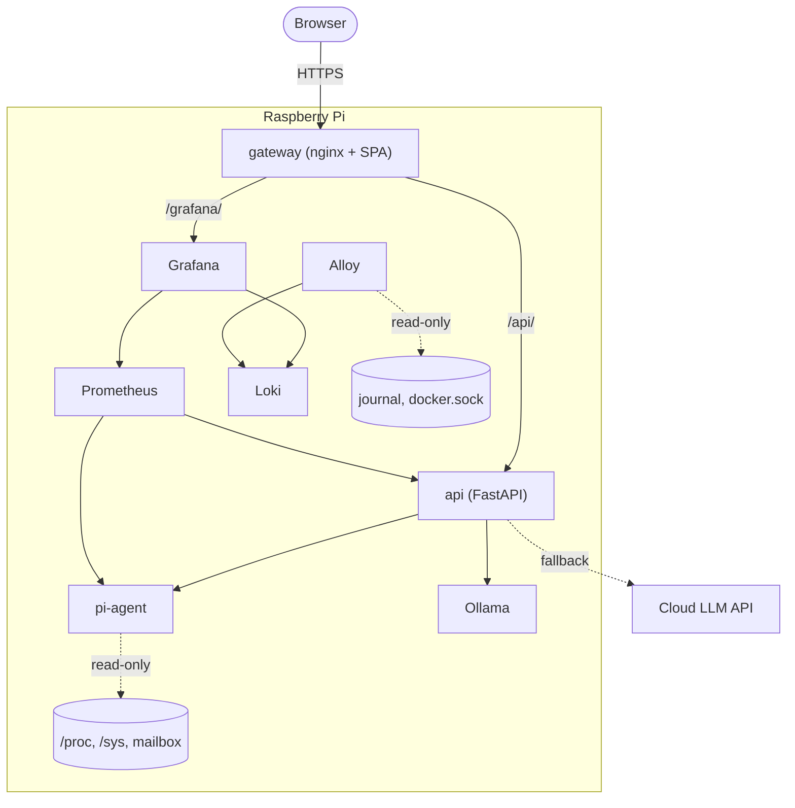
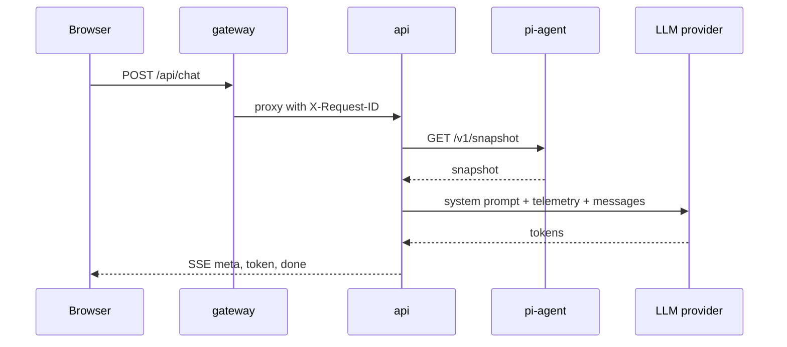

# Architecture

Everything runs on one Raspberry Pi 4 or 5 with 64-bit Raspberry Pi OS (Debian
12 or 13). The Bash scripts in `infra/` set up and harden the host, and a Docker
Compose stack in `deploy/` runs the services. The reasons behind the bigger
choices are in the [decision records](adr/README.md).

The gateway is the unprivileged nginx image with the React build from
[`web/`](../web/README.md) baked in. It does TLS, basic auth and rate limiting,
and proxies `/api/` to the [API](../api/README.md) and `/grafana/` to Grafana.
The [agent](../agent/README.md) samples the host and serves `/v1/snapshot` and
`/metrics` on port 9110. Ollama is optional and only starts with the `ollama`
Compose profile. Prometheus keeps 15 days or 2 GB, Loki keeps 7 days, and Alloy
feeds Loki the container logs, the host journal and the fail2ban log.

## Live telemetry

The agent reads `/proc`, `/sys` and the firmware every `PI_AGENT_INTERVAL`
(default 2 s) and keeps only the latest sample. CPU usage and network rates are
deltas between two samples, timed on the monotonic clock so an NTP step can't
cause a spike. A counter that goes backwards gives a rate of 0.

The API fetches `/v1/snapshot` with a 2 s timeout, validates it, and caches the
result (or the error) for a second, so concurrent requests share one fetch.
`/api/system/stream` pushes a `snapshot` SSE event every
`PICLOUD_STREAM_INTERVAL_S` (2 s), or an `error` event while the agent is down,
without closing the stream. nginx doesn't buffer it. The browser keeps the last
5 minutes for the charts.

The snapshot shape is defined three times: the Go struct in
[`snapshot.go`](../agent/internal/collector/snapshot.go), the pydantic model in
[`agent_client.py`](../api/src/picloud_api/agent_client.py), and the TypeScript
types in [`types.ts`](../web/src/api/types.ts). Change one, change all three.

## Chat

There are two rate limits. nginx allows 30 chat requests a minute per IP (burst
10), and the API has its own bucket of 20 a minute (`PICLOUD_CHAT_RATE_LIMIT`).
The API only trusts `X-Forwarded-For` from the gateway's fixed address,
`172.30.0.10`, so nobody can pick their own rate-limit key by talking to the API
directly. If `PICLOUD_API_KEY` is set, the request also needs a matching
`X-API-Key`. The body can hold 50 messages of up to 8000 characters, and the
last one has to be from the user.

With `include_system_context` on (the default), the system prompt gets a short
summary of the snapshot: temperature, CPU, memory, disk, throttle flags, uptime
and Pi model.

The router walks `PICLOUD_PROVIDER_ORDER`, which defaults to Ollama, Anthropic,
then the OpenAI-compatible provider
([ADR-0002](adr/0002-local-first-llm-fallback.md)). Providers that aren't set
up are skipped. Transient errors get two retries with backoff before it moves
on, but only until the first token. After that the provider owns the answer, and a
failure ends the stream with an `error` event. Each provider also has a circuit
breaker: three failures in a row and it's skipped for 30 s, then one trial
request decides whether it comes back.

The `done` event reports the provider, model, token counts, `ttft_ms`,
`latency_ms` and any fallbacks.

## Metrics, alerts and logs

Prometheus scrapes the agent (`pi_*`), the API (`picloud_*`), Loki, Alloy,
Grafana and itself every 15 s. The API labels requests by route template, not
raw path, so the series count stays small.

The 11 alert rules are in
[`picloud-alerts.yml`](../deploy/prometheus/rules/picloud-alerts.yml), with
`promtool` tests next to them in
[`tests/`](../deploy/prometheus/tests/picloud-alerts.test.yml). There's no
Alertmanager, so nothing notifies you. Firing alerts show in a table at the top
of the Grafana dashboard, and [operations.md](operations.md#alerts) says what to
do about each one.

nginx, the API and the agent all log JSON lines. nginx passes its request ID
upstream as `X-Request-ID`, so one Loki query finds every line for a request.
The API never logs prompts, answers or keys.

## Network

The host has three ports open: SSH, and 80 and 443 for the gateway. Port 80
only redirects to HTTPS and serves ACME challenges. Prometheus listens on
`127.0.0.1:9090` for SSH tunnels. Everything else is only on the Docker network.

That network is `172.30.0.0/24`, and containers only get dynamic addresses from
`172.30.0.128/25`, which keeps `172.30.0.10` free for the gateway. If the subnet
clashes with your LAN, change it in `docker-compose.yml`.

Published Docker ports skip UFW, which is why only the gateway publishes
anything. [security.md](security.md) has the details and the rest of the threat
model.

## When things fail

- If the agent stops, `AgentDown` fires after 2 minutes. `/api/system` returns
  503, the dashboard shows "Offline" with the last values dimmed, and the chat
  carries on without live data.
- If the agent's sampler hangs (on a dead mount, say), its `/healthz` returns
  503 after three missed intervals and Docker marks it unhealthy. The dashboard
  shows "Stale" once `collected_at` stops moving for 15 s.
- If the API stops, `ApiDown` fires after 2 minutes and `/api/` returns 502. The
  SPA and Grafana stay up, because nginx resolves upstreams per request. The
  browser reconnects with backoff.
- `ProviderCircuitOpen` fires when a circuit stays open for 5 minutes, and
  `ChatErrorRateHigh` when more than 25% of chats fail over 10 minutes. If no
  provider can start at all, the API returns 503 `all_providers_failed`.
- If the agent can't read the throttle state, `throttling.supported` is `false`
  and `pi_throttled` isn't exported, so the throttle alerts can never fire. See
  [operations.md](operations.md#the-throttle-panel-is-empty).
- Every container has a memory limit. If Ollama gets killed, Docker restarts it
  and the chat uses the next provider in the meantime.
- Prometheus, Loki, journald and Docker logs all have size or age caps, and
  `PiDiskAlmostFull` fires above 85%.
- After a power cut, `picloud.service` starts the stack at boot. With log2ram
  on, you lose the logs written since its last sync.
