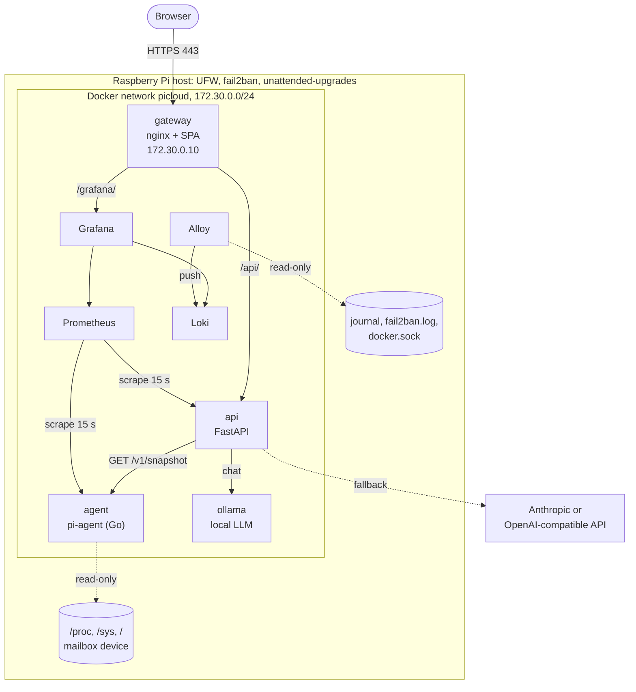
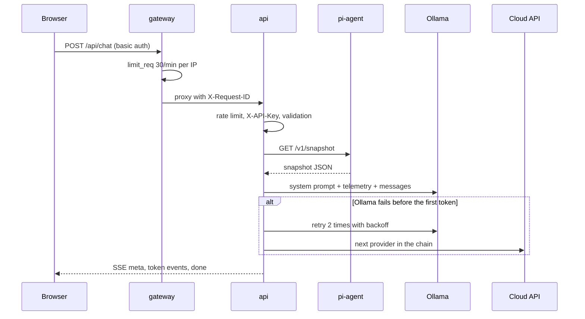

# Architecture

PiCloud runs on one Raspberry Pi 4 or 5 with 64-bit Raspberry Pi OS (Debian 12
or 13). The host toolkit in `infra/` prepares the host. A Docker Compose stack in
`deploy/` runs the services. Only the nginx gateway is open to the network.

This page gives the components, the data flows, the ports, the trust boundaries
and the failure modes. The [decision records](adr/README.md) give the reasons
for the main technology choices.

## Components

Prometheus also scrapes itself, Loki, Alloy and Grafana. The diagram leaves out
these edges.

| Component | Code | Image | Role |
| --- | --- | --- | --- |
| Host toolkit | [`infra/`](../infra/README.md) | none (Bash on the host) | Hardens the host, installs Docker and starts the stack at boot. |
| gateway | [`deploy/nginx/`](../deploy/nginx/), [`web/`](../web/README.md) | `ghcr.io/reec1e33/picloud-gateway` (nginx-unprivileged 1.30.5) | Terminates TLS, applies basic auth and rate limits, serves the React SPA, and proxies `/api/` and `/grafana/`. |
| api | [`api/`](../api/README.md) | `ghcr.io/reec1e33/picloud-api` (Python 3.12) | System API, SSE telemetry stream, and the AI gateway with provider fallback. |
| agent | [`agent/`](../agent/README.md) | `ghcr.io/reec1e33/picloud-agent` (distroless) | Reads host data every 2 s. Serves a JSON snapshot and Prometheus metrics. |
| ollama | upstream | `ollama/ollama:0.35.0` | Local LLM. Optional: Compose profile `ollama`. |
| prometheus | [`deploy/prometheus/`](../deploy/prometheus/) | `prom/prometheus:v3.15.0` | Scrapes 6 targets every 15 s. Evaluates 11 alert rules. |
| grafana | [`deploy/grafana/`](../deploy/grafana/) | `grafana/grafana:13.2.3` | The provisioned `PiCloud overview` dashboard (34 panels). |
| loki | [`deploy/loki/`](../deploy/loki/config.yml) | `grafana/loki:3.7.8` | Log store. 7-day retention. |
| alloy | [`deploy/alloy/`](../deploy/alloy/config.alloy) | `grafana/alloy:v1.20.1` | Ships container logs, the host journal and the fail2ban log to Loki. |

## Data flows

### Live telemetry

1. The agent sampler reads `/proc`, `/sys` and the firmware every
   `PI_AGENT_INTERVAL` (2 s). It keeps the latest sample in memory.
2. CPU usage and network rates are deltas between two samples. The agent
   clamps each CPU counter delta at zero, and a counter that goes back gives a
   rate of 0. The rates use the monotonic clock, so an NTP time step does not change
   them.
3. The API fetches `GET /v1/snapshot` with a 2 s timeout. It validates the JSON
   against a pydantic model and caches the result (or the error) for 1 s.
   Concurrent callers share one fetch.
4. `GET /api/system/stream` sends one `snapshot` event every
   `PICLOUD_STREAM_INTERVAL_S` (2 s). If the agent fails, it sends an `error`
   event and the stream stays open.
5. nginx passes the stream through with no buffer. The browser keeps 5 minutes
   of samples in a ring buffer for the charts.

Three definitions describe the snapshot: the Go struct
([`snapshot.go`](../agent/internal/collector/snapshot.go)), the pydantic model
([`agent_client.py`](../api/src/picloud_api/agent_client.py)) and the
TypeScript types ([`types.ts`](../web/src/api/types.ts)). An integration check on
2026-10-02 compared all 52 key paths of the three definitions and the live
agent output. They agreed on each key, type and null rule.

### Chat request

1. The gateway checks the basic-auth credentials and the per-IP limit (30
   requests per minute, burst 10). It adds `X-Request-ID` and replaces
   `X-Forwarded-For` with the client address.
2. The API applies its own token bucket (20 requests per minute per client
   address). It trusts `X-Forwarded-For` only from the gateway address
   `172.30.0.10`.
3. If `PICLOUD_API_KEY` is set, the API checks `X-API-Key` in constant time.
4. The API validates the body: 1 to 50 messages, 1 to 8000 characters each, and
   the last message from the user.
5. The API builds the system prompt. When `include_system_context` is true, the
   prompt includes a summary of the snapshot: temperature, CPU, memory, disk,
   throttle flags, uptime and Pi model.
6. The router tries the providers in order
   ([ADR-0002](adr/0002-local-first-llm-fallback.md)). It sends a `meta` event
   for each provider that it starts to use.
7. The answer arrives as `token` events. The `done` event gives the provider, the
   model, the token use, `ttft_ms`, `latency_ms` and `fallbacks`.

### Metrics and alerts

- Prometheus scrapes `agent:9110`, `api:8000/metrics`, Loki, Alloy, Grafana and
  itself every 15 s. Retention is 15 days or 2 GB.
- The agent exports `pi_*` metrics. The API exports `picloud_*` metrics. The
  route label is the path template, so the label count stays small.
- [`picloud-alerts.yml`](../deploy/prometheus/rules/picloud-alerts.yml) has 11
  rules. [`picloud-alerts.test.yml`](../deploy/prometheus/tests/picloud-alerts.test.yml)
  tests them with `promtool`.
- The stack has no Alertmanager. Grafana shows the active alerts in a table.
  [operations.md](operations.md#alerts) gives the first response for each
  alert.

### Logs

- nginx, the API and the agent write one JSON object per line to stdout. nginx
  and the API include the request ID, so one query finds all lines of a
  request.
- Docker rotates the container logs (3 files of 10 MB each).
- Alloy sends the container logs, the host journal and the fail2ban log to
  Loki. Loki keeps them for 7 days.
- The API never logs prompts, answers or API keys.

## Network and ports

| Port | Bound to | Service | Exposure |
| --- | --- | --- | --- |
| 22/tcp | host | sshd | LAN, or internet if you forward it. UFW `limit` and fail2ban. |
| 80/tcp | `0.0.0.0` | gateway (container 8080) | Public. Redirect to HTTPS and ACME challenges only. |
| 443/tcp | `0.0.0.0` | gateway (container 8443) | Public. TLS 1.2/1.3, HTTP/2, basic auth. |
| 9090/tcp | `127.0.0.1` | Prometheus | SSH tunnel only. |
| 8000/tcp | not published | api | Docker network only. |
| 9110/tcp | not published | agent | Docker network only. |
| 11434/tcp | not published | ollama | Docker network only. |
| 3000/tcp | not published | grafana | Through the gateway at `/grafana/`. |
| 3100/tcp | not published | loki | Docker network only. |
| 12345/tcp | not published | alloy | Docker network only. |

The Docker network has the fixed subnet `172.30.0.0/24`. Containers get dynamic
addresses from `172.30.0.128/25` only. The gateway has the static address
`172.30.0.10`.

Docker writes its own iptables rules for published ports, and these rules come
before the UFW rules. Thus the stack publishes only ports 80 and 443 on all
interfaces. `infra/verify.sh` warns about any other published port.

## Trust boundaries

1. **Internet to router.** The router forwards only ports 80 and 443 to the Pi.
   You can also forward SSH. [setup.md](setup.md#step-11-forward-ports-and-set-up-dynamic-dns)
   gives the choices.
2. **Network to host.** UFW blocks all inbound traffic except SSH, 80, 443 and
   the optional LAN-only ports. fail2ban bans addresses after failed SSH logins.
3. **Client to gateway.** TLS, basic auth on all HTTPS paths except
   `/api/health`, security headers, request size limits and a rate limit on the
   chat.
4. **Gateway to services.** Plain HTTP on the private Docker network. The API
   trusts `X-Forwarded-For` only from the gateway. Grafana does not get the
   basic-auth header.
5. **API to cloud providers.** Outbound HTTPS with the keys from `deploy/.env`.
   The provider receives the chat messages and, if the context option is on,
   the telemetry summary.
6. **Containers to host.** The agent reads `/proc`, `/sys` and `/` as read-only
   mounts, and uses the firmware mailbox device. It does not share the PID
   namespace of the host. Alloy reads the Docker socket, `/var/log` and the
   journal. No other container has access to the host.

[security.md](security.md) gives the threat model and each control.

## Failure modes

| Failure | Detection | Behavior |
| --- | --- | --- |
| The agent stops. | `AgentDown` alert after 2 min. The API agent fetch fails after 2 s. | `/api/system` returns 503. The stream sends `error` events and stays open. The dashboard shows "Offline" and dims the last values. The chat prompt says that live data is not available. `/api/ready` returns 503. |
| The agent sampler hangs, for example on a dead mount. | `/healthz` returns 503 after 3 intervals, so Docker marks the container unhealthy. | The API continues to serve the last sample. The dashboard shows "Stale" when `collected_at` does not change for 15 s. |
| The API stops. | `ApiDown` alert after 2 min. | The gateway returns 502 on `/api/`. The SPA and Grafana stay available, because nginx resolves the upstreams for each request. The browser reconnects with backoff (maximum 30 s). |
| A provider fails before the first token. | `fallbacks` in the `done` event. `picloud_provider_fallbacks_total`. | The router retries transient errors 2 times (0.5 to 1 s, then 1 to 2 s), then tries the next provider. |
| A provider fails after the first token. | SSE `error` event with `provider_error`. | No fallback. The partial answer stays on the screen. With `stream: false`, the API returns 502. |
| A provider circuit opens. | `ProviderCircuitOpen` alert after 5 min. `/api/providers` shows `open`. | The router skips the provider (`circuit_open`). After 30 s, the circuit goes to half-open, and the next request tests the provider. |
| No provider can answer. | `ChatErrorRateHigh` alert (more than 25 % errors over 10 min). | 503 with `all_providers_failed` if no provider started, else an SSE `error` event. |
| The Pi is hot, throttled or has under-voltage. | `PiHighTemperature`, `PiCriticalTemperature`, `PiThrottledNow`, `PiUnderVoltageNow`. The throttle panel of the dashboard. | The chat prompt includes the throttle flags and the temperature, so the model can explain the cause. |
| The agent cannot read the throttle state. | `throttling.supported` is `false`. A warning in the agent log. | The agent does not export `pi_throttled`, so the two throttle alerts cannot fire. See [operations.md](operations.md#the-throttle-panel-is-empty). |
| The disk is almost full. | `PiDiskAlmostFull` (more than 85 % for 15 min). | Retention limits apply: Prometheus 15 days or 2 GB, Loki 7 days, journald 200 MB, Docker logs 30 MB per container. |
| Memory is low, or Ollama runs out of memory. | `PiMemoryPressure` (less than 10 % available for 10 min). | Each container has a memory limit. Docker restarts a stopped container. While Ollama is down, the chat uses the next provider. |
| Loki, Grafana, Alloy or Prometheus stops. | `ObservabilityTargetDown` after 5 min. | The dashboard and the chat continue to work. |
| Docker Engine restarts for an update. | none | `live-restore` keeps the containers alive. |
| The power fails. | none | At boot, `picloud.service` starts the stack. The journal is on disk. With log2ram on, the logs since the last sync are lost. |
| The public IP address changes. | none | `ddclient` updates the DNS name, if you set up the `ddns` module. |

## Technology choices

| Choice | Reason | Record |
| --- | --- | --- |
| Go for the agent | Static binary, small image, cross-compile with no emulation. | [ADR-0001](adr/0001-go-host-agent.md) |
| Local-first fallback chain | The local model costs nothing. A cloud model answers when the local model fails. | [ADR-0002](adr/0002-local-first-llm-fallback.md) |
| Docker Compose, one node | One Pi needs no scheduler. One file describes the stack. | [ADR-0003](adr/0003-docker-compose-single-node.md) |
| Grafana Alloy | Promtail is at end of life. | [ADR-0004](adr/0004-grafana-alloy-for-logs.md) |
| Bash for the host | No agent to install, dry run, rollback, one host. | [ADR-0005](adr/0005-bash-host-provisioning.md) |
| Basic auth and X-API-Key | No user database. The chat can have a separate secret. | [ADR-0006](adr/0006-basic-auth-and-api-key.md) |
| Server-Sent Events | Plain HTTP through nginx. One direction is sufficient. | [ADR-0007](adr/0007-server-sent-events.md) |
| FastAPI | Async streams to many providers, typed models, OpenAPI docs at `/api/docs`. | none |
| React, Vite, Tailwind CSS | Typed SPA, small first load (Recharts loads in a separate chunk). | none |
| nginx-unprivileged | The gateway runs as UID 101 with a read-only root filesystem. | none |
